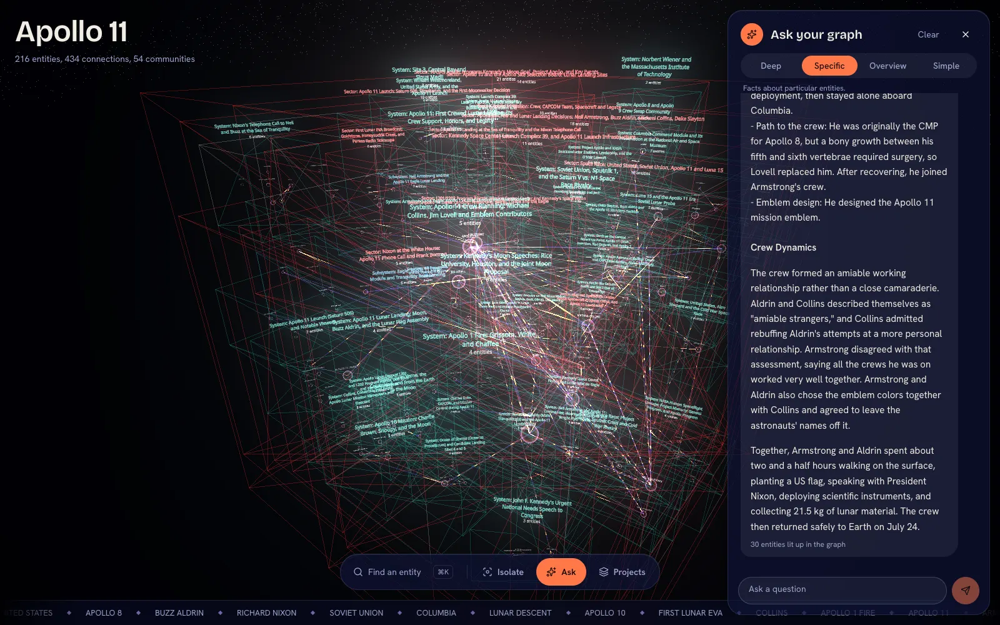

# Local GraphRAG

   

Drop in your documents. Get a 3D map of the people, things and ideas inside them. Then ask questions and watch the answer light up on the map.

Bring your own model: **OpenAI**, **Claude** or **Gemini** with an API key, or go fully offline with **Ollama**. Embeddings run locally by default, or through the OpenAI / Gemini API if you prefer.



## What it does

1. You add PDFs or `.txt` files.
2. It reads them and pulls out **entities** (people, companies, drugs, places...) and how they **connect**.
3. It groups related entities into **communities** and writes a short summary for each.
4. You explore the result as a 3D graph, or ask questions in a chat.

## Features

- **Three cloud adapters: OpenAI, Claude and Gemini.** Paste an API key in the app (or `.env`), pick a model, build. One adapter file (`lib/providers.ts`) describes each provider.
- **Your choice of embeddings.** Use a free local Hugging Face model (`BAAI/bge-base-en-v1.5`, runs on CPU), or the OpenAI / Gemini embedding API.
- **Claude without an API key.** No Anthropic key? A small local bridge talks to Claude through your Claude Code login instead.
- **Fully offline option.** An Ollama preset runs both extraction and embeddings on local models.
- **Interactive 3D graph.** Force-directed layout with search, details on click, and answers highlighted on the map.
- **Four ways to ask.** Deep, specific, overview and simple search modes.
- **Projects and archives.** Keep several graphs, save snapshots, import and export them.
- **Keys stay private.** Saved with owner-only file permissions, never sent to the browser, masked in logs.
- **PDF and `.txt` input.**

## Documentation

New to GraphRAG, embeddings or knowledge graphs? The [docs](docs/README.md) explain every part in plain words, from "what is an embedding?" to a tour of every file.

## Run it

### 1. Install

You need: Node 20.9+, [pnpm](https://pnpm.io), Python 3.12 and [uv](https://docs.astral.sh/uv/).

```bash
git clone https://github.com/Vamsitallapudi9/local-graphrag.git
cd local-graphrag
pnpm install
uv sync --frozen
```

### 2. Get an API key for the model you want

| Provider | Get a key | `.env` variable | Default model | Embedding options |
|----------|-----------|-----------------|---------------|-------------------|
| **OpenAI** | [platform.openai.com/api-keys](https://platform.openai.com/api-keys) | `OPENAI_API_KEY` | `gpt-5.4-mini` | Local model, or `text-embedding-3-small` |
| **Claude** | [console.anthropic.com/settings/keys](https://console.anthropic.com/settings/keys) | `ANTHROPIC_API_KEY` | `claude-sonnet-5-5` | Local model (Anthropic has no embedding API) |
| **Gemini** | [aistudio.google.com/apikey](https://aistudio.google.com/apikey) | `GEMINI_API_KEY` | `gemini-flash-latest` | Local model, or `gemini-embedding-001` |
| **Ollama** (offline) | No key. Install [Ollama](https://ollama.com/download) | none | `gemma4` | `embeddinggemma` (local) |

You can paste the key in the app later (**Projects → Model settings**), or put it in a `.env` file now:

```bash
cp .env.example .env    # then fill in only the key(s) you need
```

Keys are never committed: `.env` and `.graphrag/` are in `.gitignore`.

> **Claude without a key:** if [Claude Code](https://claude.com/claude-code) is installed and logged in, you can leave `ANTHROPIC_API_KEY` empty and Claude will be reached through the `claude` CLI (slower, but no API bill).

### 3. Download the embedding model (before your first build)

If you use the **local** embedding model (the default, and the only option for Claude), download it once (about 220 MB, saved in `.graphrag/hf-models/`):

```bash
pnpm download-embeddings
```

Skipping this is fine, because the first build downloads it automatically. It just makes that build slower. Using OpenAI or Gemini embeddings instead? Choose them in **Model settings**. There is nothing to download.

For Ollama, open **Model settings → Ollama** and press **Pull model** for both models (or run `ollama pull gemma4` and `ollama pull embeddinggemma`).

### 4. Start

```bash
pnpm dev
```

Open http://127.0.0.1:3000.

## Use it

1. Open **Projects**, name a project and add files. Pick a provider in the dropdown (check its key and model under **Model settings**), then press **Build with …**.
2. Close the panel. Drag to rotate, scroll to zoom, click a dot to see details, `Cmd/Ctrl+K` to search.
3. Open **Ask** to chat. Pick a mode:

| Mode | Use it for |
|------|-----------|
| Deep | Following links between topics (default) |
| Specific | Facts about one thing |
| Overview | Big themes across all documents |
| Simple | Plain search over the text |

## Privacy

Your files, graph and keys stay on your machine. When you build or ask with **OpenAI, Claude or Gemini**, the text pieces being read are sent to that provider, and so is the text being embedded if you chose their embedding API. Don't use confidential or personal data with a cloud provider. Use the **Ollama** preset with local embeddings to keep everything on your computer.

## Project layout

```
app/              pages and API routes (Next.js)
components/       the 3D graph, chat, projects panel, model settings
lib/providers.ts  the OpenAI / Claude / Gemini / Ollama adapters
lib/server/       provider config, build runner, PDF + Parquet converters
scripts/          local helpers: embedding server, Claude Code bridge
settings.yaml     GraphRAG settings (filled in from the chosen adapter)
prompts/          the instructions GraphRAG gives the model
docs/             beginner-friendly documentation
```

A full file-by-file tour is in [docs/08-code-tour.md](docs/08-code-tour.md).

## Checks

```bash
pnpm typecheck && pnpm lint && pnpm build
```

## License

MIT. See [LICENSE](LICENSE). Built on [Microsoft GraphRAG](https://github.com/microsoft/graphrag), originally based on an MIT-licensed project (see LICENSE).
